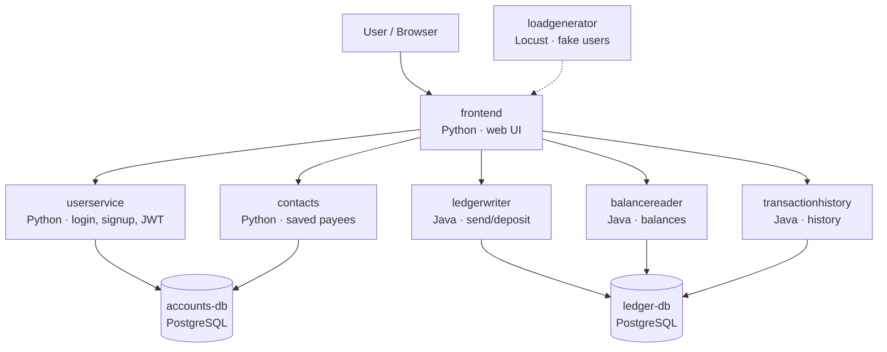

# Bank DevOps Project — Bank of Anthos on AWS EKS

A DevOps practice project: taking Google's **Bank of Anthos** (a GCP-native microservice banking app) and running it in an AWS environment.

> Demo app only. Not a real bank. Upstream source: [GoogleCloudPlatform/bank-of-anthos](https://github.com/GoogleCloudPlatform/bank-of-anthos) (Apache 2.0, see `LICENSE-upstream`).

---

## What the app does

A simulated online bank where users can sign up, log in, check their balance, view transaction history, deposit funds, and send payments to other users. A load generator simulates real users to keep the system busy.

## Architecture (three-tier, microservices)



| Tier | Services | Role |
|---|---|---|
| **Presentation** | `frontend` | Website; the only service exposed outside Docker |
| **Application** | `userservice`, `contacts` (accounts domain); `ledgerwriter`, `balancereader`, `transactionhistory` (ledger domain) | Business logic APIs, all on port 8080 internally |
| **Data** | `accounts-db`, `ledger-db` | PostgreSQL: user accounts and the transaction ledger |

### How auth works
`userservice` signs a **JWT** with a private RSA key at login. Every other service verifies requests with the matching **public key**. Keys are mounted at `/tmp/.ssh/` in each container.

### How services find each other
Each service reads peer addresses from environment variables (e.g. `BALANCES_API_ADDR=balancereader:8080`), resolved through Docker Compose's internal DNS.

---

## Environment

| Component | Details |
|---|---|
| Admin box | EC2 `t3.large`, Ubuntu 24.04, 30 GB gp3, `us-east-1` |
| AWS access | IAM instance role (`devops-admin-box-role`), no access keys on disk |
| Network access | SSH restricted to a single IP; app viewed through an SSH / VS Code Remote-SSH port forward (no public app ports) |
| Tooling | Git, Docker + Compose, AWS CLI v2, Terraform, kubectl, Helm |
| Local runtime | Docker Compose using upstream prebuilt images (`v0.6.11`) |

### Planned tooling (upcoming phases)

| Area | Tool | Purpose |
|---|---|---|
| Container registry | **Amazon ECR** | Store images built from this repo's source |
| Infrastructure as code | **Terraform** | Provision VPC, EKS cluster, RDS (PostgreSQL), Secrets Manager |
| Orchestration | **Amazon EKS** | Run the microservices on Kubernetes |
| CI | **GitHub Actions** | Build, test, and push images on every commit |
| Dependency security | **Dependabot** | Automated PRs for vulnerable or outdated dependencies |
| Code security | **CodeQL** | Static analysis for security flaws in the source |
| CD / GitOps | **Argo CD** | Keep the cluster in sync with manifests in Git |
| Ingress | **AWS Load Balancer Controller (ALB)** | Expose the frontend on a public URL |
| Secrets | **AWS Secrets Manager + External Secrets Operator** | Deliver DB credentials to pods without storing them in Git |
| Observability | **Prometheus + Grafana** | Metrics, dashboards, SLOs, and alerts |

---

## Repo layout

```
├── src/                  # Bank of Anthos microservice source code
├── docker-compose.yaml   # Local three-tier stack
├── local/
│   ├── env/              # *.env.example templates (real .env files are git-ignored)
│   └── jwt/              # Local JWT keys (git-ignored, never committed)
└── TEARDOWN.md           # Log of billable resources, destroyed in reverse order
```

---

## Run locally

Prerequisites: Docker with the Compose plugin, OpenSSL.

```bash
# 1. Create env files from templates and fill in values
for f in local/env/*.env.example; do cp "$f" "${f%.example}"; done

# 2. Generate JWT signing keys
mkdir -p local/jwt
openssl genrsa -out local/jwt/privatekey 4096
openssl rsa -in local/jwt/privatekey -pubout -out local/jwt/publickey
chmod 644 local/jwt/*

# 3. Start the stack (Java services take ~1–2 min to become ready)
docker compose up -d
docker compose ps

# 4. Optional: start simulated users
docker compose --profile load up -d
```

Open **http://localhost:8080**. Demo login: `testuser` / `bankofanthos`.

| Command | Effect |
|---|---|
| `docker compose down` | Stop everything, keep data |
| `docker compose down -v` | Stop everything and reset databases to demo data |

---

## GCP-specific issues fixed

| Issue | Cause | Fix |
|---|---|---|
| Tracing/metrics calls to Google Cloud | `ENABLE_TRACING` / `ENABLE_METRICS` default to Google Cloud Trace & Monitoring | Set to `"false"` in Compose |
| Java services crash-loop on startup | Stackdriver config cuts `HOSTNAME` at the first `-` to build a label; Docker hostnames (12-char container IDs) have no dash → `StringIndexOutOfBoundsException` | Workaround: Kubernetes-style hostnames in Compose (e.g. `balancereader-local`) |

---

## Secrets handling

- Demo DB credentials live in git-ignored `local/env/*.env` files; only `*.env.example` templates (values replaced with `CHANGE_ME`) are committed.
- JWT keys are generated locally and git-ignored.

---

## Observed resource usage (local, with load generator)

| Component | Memory |
|---|---|
| Java services (×3) | ~220–285 MiB each |
| Python services (×3) | ~85–105 MiB each |
| PostgreSQL (×2) | ~30–70 MiB each |
| **Total app** | **~1.3 GiB** |

`userservice` is the most CPU-intensive under load (password hashing on login).

---

## Progress

- [x] **Phase 0:** Admin box, tooling, repo skeleton
- [x] **Phase 1:** Full stack running locally with Docker Compose